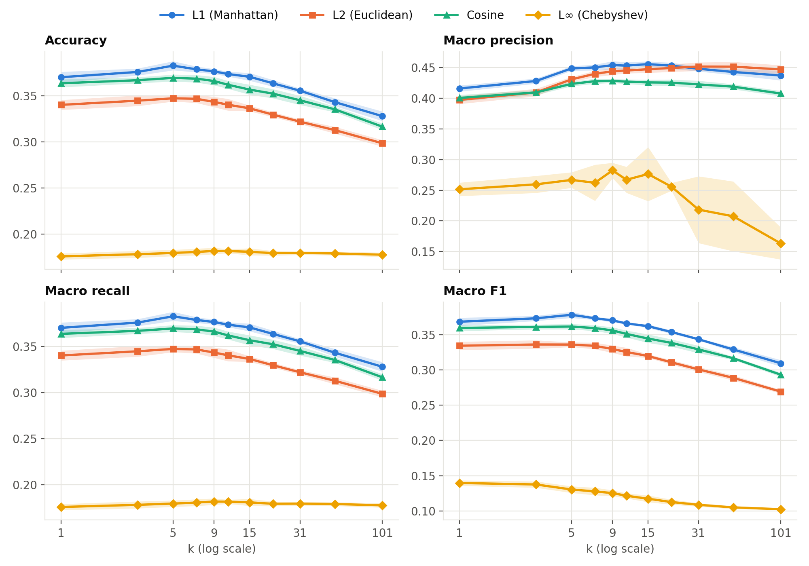
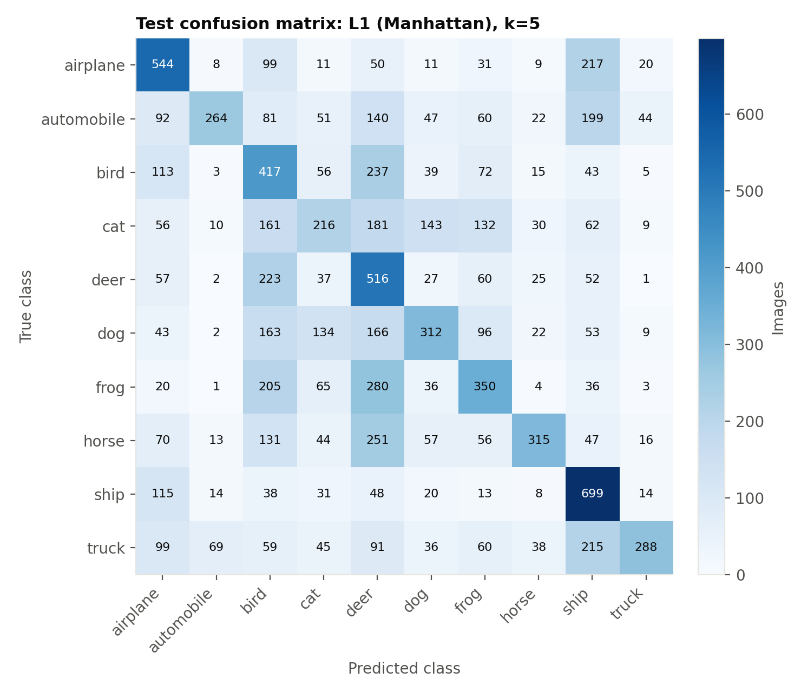
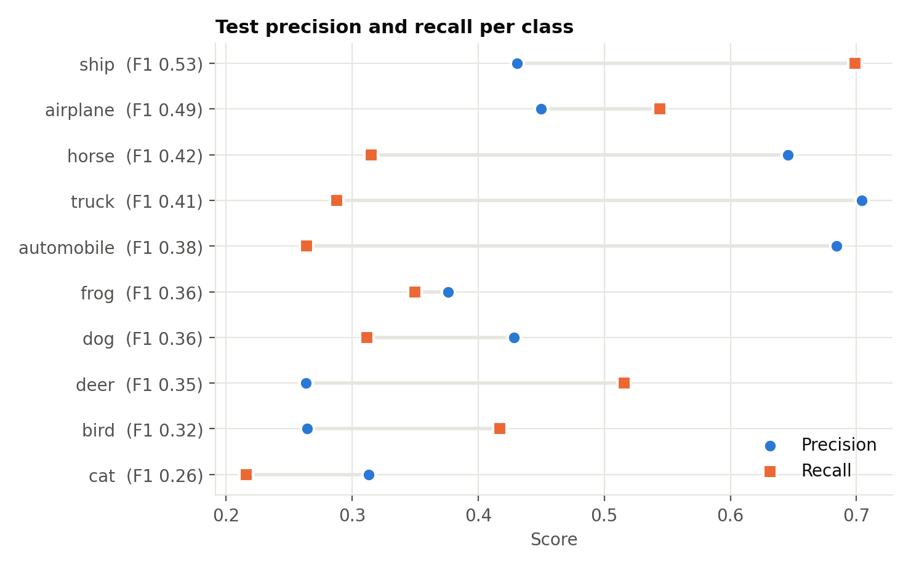

# K-Nearest Neighbors Classification on CIFAR-10

Date: November 4, 2026 · [한국어 버전](report_ko.md)

## 1. Summary

- The best combination was **L1 distance with k=5**. It reached 38.27% accuracy and a macro F1 of 0.3781 in 5-fold cross-validation, and 39.21% accuracy and a macro F1 of 0.3890 on the test set.
- Performance by distance metric ranked **L1 > Cosine > L2 ≫ L∞**. L1 had higher accuracy than Cosine in all five folds, and Cosine had higher accuracy than L2 in all five folds (each at its selected k).
- These results are well above the 10% accuracy of random guessing across 10 classes, but KNN on raw pixels stayed below 40%.

## 2. Experimental setup

| Item | Details |
|---|---|
| Data | CIFAR-10: 50,000 training and 10,000 test images (32×32×3 = 3,072 dimensions, balanced classes) |
| Input features | Raw pixel values (0–255), with no preprocessing |
| Values of k | 1, 3, 5, 7, 9, 11, 15, 21, 31, 51, 101 (11 values) |
| Distance metrics | L1 (Manhattan), L2 (Euclidean), Cosine, L∞ (Chebyshev) (4 metrics) |
| Validation | Stratified 5-fold cross-validation on the training data (40,000 training and 10,000 validation images per fold, seed=42) |
| Model selection | The k with the highest mean cross-validation macro F1 |
| Evaluation metrics | Accuracy, Precision, Recall, F1 (the last three are macro-averaged) |

The test set was not used to select k. After selection, test predictions were made using all 50,000 training images.

Because CIFAR-10 has the same number of images in every class, **macro recall and accuracy are mathematically identical**. This is why those two values match in the tables below.

## 3. Implementation

KNN and the evaluation metrics were implemented from scratch with NumPy in `knn.py`. The classifier does not use scikit-learn.

- **Distance computation**: Each query is compared with every training image (brute force). Pixels remain integers from 0 to 255; the usual rescaling to [0, 1] would not change the neighbor order for L1, L2, or L∞, and Cosine is unaffected by scale.
- **Voting**: The prediction is the majority class among the k neighbors. A tie goes to the tied class with the closest neighbor.
- **Efficiency**: The 101 nearest neighbors of each query are computed once, and the prediction for each k uses the first k entries of that list.
- **Verification** (`test_knn.py`, all checks passed): Distances for all four metrics were compared with scikit-learn. L2 and Cosine were also compared with a direct computation that does not use the matrix-product library. Accuracy, Precision, Recall, and F1 also matched scikit-learn. These comparisons used a subset of the data (up to 3,000 training images and 500 queries).

## 4. Cross-validation results

Values are means over the five folds, and the highest value in each column is in bold. Full results, including standard deviations, are in `results/cv_summary.csv`.

### Accuracy

| k | L1 | L2 | Cosine | L∞ |
|---|---|---|---|---|
| 1 | 0.3702 | 0.3402 | 0.3636 | 0.1760 |
| 3 | 0.3759 | 0.3447 | 0.3669 | 0.1783 |
| 5 | **0.3827** | **0.3473** | **0.3695** | 0.1797 |
| 7 | 0.3787 | 0.3468 | 0.3686 | 0.1808 |
| 9 | 0.3765 | 0.3434 | 0.3661 | **0.1819** |
| 11 | 0.3736 | 0.3404 | 0.3620 | 0.1817 |
| 15 | 0.3706 | 0.3364 | 0.3567 | 0.1810 |
| 21 | 0.3636 | 0.3296 | 0.3524 | 0.1795 |
| 31 | 0.3555 | 0.3220 | 0.3451 | 0.1796 |
| 51 | 0.3432 | 0.3128 | 0.3353 | 0.1792 |
| 101 | 0.3280 | 0.2986 | 0.3166 | 0.1778 |


### Macro Precision

| k | L1 | L2 | Cosine | L∞ |
|---|---|---|---|---|
| 1 | 0.4159 | 0.3972 | 0.4005 | 0.2516 |
| 3 | 0.4281 | 0.4095 | 0.4095 | 0.2596 |
| 5 | 0.4487 | 0.4308 | 0.4234 | 0.2668 |
| 7 | 0.4503 | 0.4398 | 0.4278 | 0.2622 |
| 9 | 0.4540 | 0.4440 | **0.4285** | **0.2824** |
| 11 | 0.4532 | 0.4452 | 0.4271 | 0.2671 |
| 15 | **0.4556** | 0.4473 | 0.4258 | 0.2765 |
| 21 | 0.4531 | 0.4494 | 0.4255 | 0.2558 |
| 31 | 0.4481 | **0.4516** | 0.4226 | 0.2184 |
| 51 | 0.4428 | 0.4515 | 0.4189 | 0.2075 |
| 101 | 0.4371 | 0.4470 | 0.4077 | 0.1633 |


### Macro Recall

| k | L1 | L2 | Cosine | L∞ |
|---|---|---|---|---|
| 1 | 0.3702 | 0.3402 | 0.3636 | 0.1760 |
| 3 | 0.3759 | 0.3447 | 0.3669 | 0.1783 |
| 5 | **0.3827** | **0.3473** | **0.3695** | 0.1797 |
| 7 | 0.3787 | 0.3468 | 0.3686 | 0.1808 |
| 9 | 0.3765 | 0.3434 | 0.3661 | **0.1819** |
| 11 | 0.3736 | 0.3404 | 0.3620 | 0.1817 |
| 15 | 0.3706 | 0.3364 | 0.3567 | 0.1810 |
| 21 | 0.3636 | 0.3296 | 0.3524 | 0.1795 |
| 31 | 0.3555 | 0.3220 | 0.3451 | 0.1796 |
| 51 | 0.3432 | 0.3128 | 0.3353 | 0.1792 |
| 101 | 0.3280 | 0.2986 | 0.3166 | 0.1778 |


### Macro F1

| k | L1 | L2 | Cosine | L∞ |
|---|---|---|---|---|
| 1 | 0.3683 | 0.3342 | 0.3594 | **0.1397** |
| 3 | 0.3731 | **0.3360** | 0.3609 | 0.1376 |
| 5 | **0.3781** | 0.3359 | **0.3614** | 0.1305 |
| 7 | 0.3732 | 0.3340 | 0.3592 | 0.1277 |
| 9 | 0.3701 | 0.3295 | 0.3559 | 0.1254 |
| 11 | 0.3659 | 0.3254 | 0.3509 | 0.1216 |
| 15 | 0.3620 | 0.3197 | 0.3444 | 0.1173 |
| 21 | 0.3537 | 0.3107 | 0.3382 | 0.1127 |
| 31 | 0.3434 | 0.3007 | 0.3290 | 0.1087 |
| 51 | 0.3290 | 0.2887 | 0.3165 | 0.1051 |
| 101 | 0.3094 | 0.2692 | 0.2932 | 0.1025 |




*Figure 1. Mean cross-validation scores by k and distance metric. Shading shows ±1 standard deviation across folds. The vertical axis range differs between panels.*

## 5. Test set results

Each distance metric uses the k selected by cross-validation.

| Distance metric | Selected k | Accuracy | Precision | Recall | F1 |
|---|---|---|---|---|---|
| L1 | 5 | 0.3921 | 0.4560 | 0.3921 | 0.3890 |
| L2 | 3 | 0.3561 | 0.4204 | 0.3561 | 0.3498 |
| Cosine | 5 | 0.3797 | 0.4332 | 0.3797 | 0.3722 |
| L∞ | 1 | 0.1828 | 0.2857 | 0.1828 | 0.1466 |


Test scores were slightly higher than cross-validation scores for every distance metric. This is probably because the number of training images rose from 40,000 to 50,000 for the test evaluation.



*Figure 2. Test set confusion matrix for the best combination (L1, k=5).*



*Figure 3. Test precision and recall per class for the best combination, sorted by F1.*

## 6. Comparison and discussion

The numbers below are measurements. The explanations of their causes are interpretations consistent with the results; they were not proven by separate experiments.

### Effect of k

Accuracy for L1, L2, and Cosine peaked at k=5 and kept falling as k grew (L1: 0.3827 at k=5, 0.3280 at k=101). This fits the bias–variance trade-off: a very small k is sensitive to noise, while a very large k lets neighbors from other classes into the vote. However, differences between k=3 and k=7 are similar to or only slightly larger than the standard deviation across folds (about 0.003–0.006), so the best k within this range is not clearly determined. For L2, the F1 scores at k=3 (0.3360) and k=5 (0.3359) were practically equal, and accuracy alone favored k=5.

In some ranges, **recall falls while precision rises** as k grows (L2: precision of 0.3972 at k=1 and 0.4516 at k=31). This is consistent with predictions concentrating on fewer classes. In fold 1, the three most-predicted classes accounted for 51.1% of L2 predictions at k=1 and 70.6% at k=101. A rarely predicted class is chosen only when most neighbors agree, which raises its precision and lowers its recall. For this reason, k was selected by F1, which reflects both precision and recall.

### Effect of the distance metric

- **L1 > L2 > L∞**: These are Minkowski distances with p = 1, 2, and ∞, and performance fell as p increased. A larger p lets a few pixels with large differences dominate the distance. We interpret this as harmful because small shifts in position or lighting can easily produce such pixels.
- **Cosine > L2**: Ranking by Cosine distance is equivalent to ranking by L2 distance after scaling each vector to unit length, so it ignores overall differences in brightness scale. The improvement over L2 (accuracy from 0.3447 to 0.3695, each at its selected k) suggests that brightness differences acted as noise for L2.
- **Failure of L∞**: Accuracy was about 18%, only somewhat better than random guessing (10%). L∞ looks only at the single largest of 3,072 differences and discards most of the information. In a sample of 100 queries, the 1st to 99th percentiles of L∞ distance spanned only 149–255. Predictions were also heavily concentrated: at k=101, the top three classes made up 93.3% of predictions, and some classes were never predicted at k=21 and k=101 (fold 1). As a result, macro F1 kept falling as k grew.
- **Computation time**: Mean time per fold was 8.8 s for L2, 8.6 s for Cosine, 145 s for L1, and 138 s for L∞. This reflects implementation rather than algorithmic complexity: L2 and Cosine can use optimized matrix products, while L1 and L∞ cannot. These times vary with the environment.

### Per-class results

For the best combination, F1 was highest for ship (0.53) and airplane (0.49) and lowest for cat (0.26). Of the 10,000 test images, 51.6% were predicted as deer (1,960), ship (1,623), or bird (1,577), far above those classes' true share of 30%.

- Automobile and truck had high precision (0.68, 0.70) but low recall (0.26, 0.29). They were rarely predicted, and many of their images were classified as ship (automobile → ship: 199, truck → ship: 215).
- Confusion between airplane and ship (airplane → ship: 217, ship → airplane: 115) is probably due to similar blue backgrounds of sky and sea.
- Frog → deer (280), horse → deer (251), and bird → deer (237) were also common. This is probably because pixel comparison depends more on overall color distribution than on object shape.

## 7. Conclusion and limitations

L1 distance with k=5 performed best in this experiment. Across k=1–15, changing the distance metric affected performance more than changing k. Even so, the best accuracy stayed below 40%. Pixel-wise distances are vulnerable to changes in object position, scale, and background, so features that capture image structure, such as HOG or CNN features, could be considered instead of raw pixels. This experiment did not test that directly.

The limitations are:

- Only raw pixels were evaluated, with no preprocessing or feature extraction.
- Only one seed (42) was used to create the folds.
- When distances are exactly equal at the boundary of the 101 nearest neighbors, only some of the tied images are included. This may affect L∞, where equal values are common.

## Appendix: How to run

```
python test_knn.py <path to cifar-10-python.tar.gz>         # verify the implementation
python run_experiments.py <path to cifar-10-python.tar.gz>  # run the full experiment
python analyze_results.py <path to cifar-10-python.tar.gz>  # supporting numbers for the discussion
python make_figures.py                                      # generate the figures
```

Environment: Python 3.12, NumPy 2.2.6, pandas 2.2.3, matplotlib 3.10.3, scikit-learn 1.6.1 (verification only). Apple M4, 16 GB of memory.
