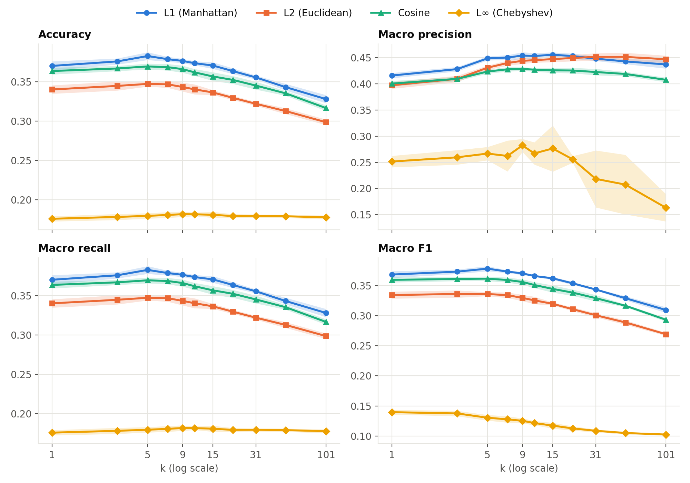
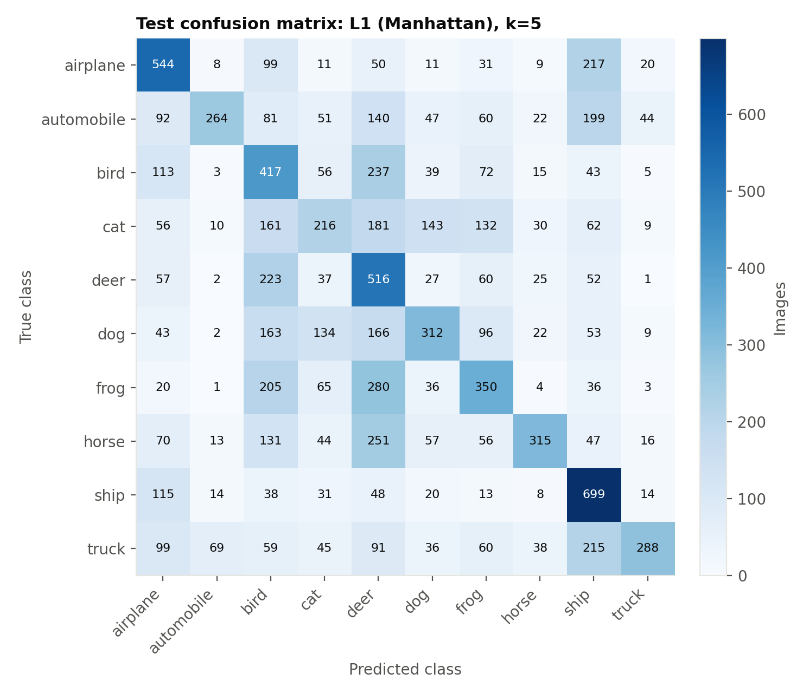
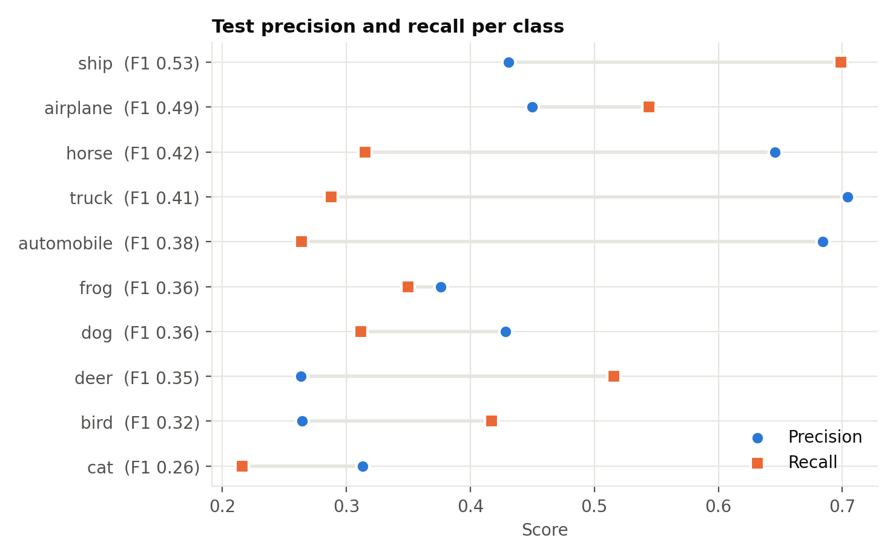

# CIFAR-10 K-최근접 이웃(KNN) 분류 실험 보고서

제출일: 2026년 11월 4일 · [English version](report.md)

## 1. 요약

- 가장 좋은 조합은 **L1 거리, k=5**입니다. 5-fold 교차검증 정확도 38.27%, macro F1 0.3781이었고, 테스트셋에서는 정확도 39.21%, macro F1 0.3890이었습니다.
- 거리 측정 방법별 성능은 **L1 > Cosine > L2 ≫ L∞** 순이었습니다. L1은 다섯 fold 모두에서 Cosine보다, Cosine은 다섯 fold 모두에서 L2보다 정확도가 높았습니다(각 방법에서 선택된 k 기준).
- 10개 클래스의 무작위 추측 정확도인 10%보다는 훨씬 높지만, 원본 픽셀만 사용하는 KNN의 성능은 40% 미만에 그쳤습니다.

## 2. 실험 방법

| 항목 | 내용 |
|---|---|
| 데이터 | CIFAR-10 학습 50,000장, 테스트 10,000장 (32×32×3 = 3,072차원, 클래스당 균등) |
| 입력 특징 | 원본 픽셀값(0–255). 전처리 없음 |
| k 값 | 1, 3, 5, 7, 9, 11, 15, 21, 31, 51, 101 (11개) |
| 거리 측정 방법 | L1(맨해튼), L2(유클리드), Cosine, L∞(체비쇼프) (4개) |
| 검증 | 학습 데이터에 대한 층화 5-fold 교차검증 (fold당 학습 40,000장, 검증 10,000장, seed=42) |
| 모델 선택 기준 | 교차검증 평균 macro F1이 가장 높은 k |
| 평가 지표 | Accuracy, Precision, Recall, F1. 뒤의 세 지표는 macro 평균 |

테스트셋은 k를 선택하는 데 사용하지 않았고, 선택이 끝난 뒤 학습 데이터 50,000장 전체로 다시 예측해 평가했습니다.

CIFAR-10은 클래스별 개수가 같기 때문에 **macro recall과 accuracy가 수학적으로 같은 값**이 됩니다. 아래 표에서 두 값이 일치하는 것은 이 때문입니다.

## 3. 구현

KNN과 평가 지표는 `knn.py`에 NumPy로 직접 구현했으며, 분류기 자체에 scikit-learn을 쓰지 않았습니다.

- **거리 계산**: 모든 학습 이미지와의 거리를 계산합니다(brute-force). 값이 0–255의 정수이므로 L1, L2, L∞의 거리 순서는 일반적인 [0, 1] 정규화를 해도 달라지지 않습니다. Cosine도 크기 조절의 영향을 받지 않습니다.
- **투표**: k개 이웃의 다수결로 정하며, 동점이면 동점 클래스 중 가장 가까운 이웃을 가진 클래스를 선택합니다.
- **효율화**: 각 질의마다 가장 가까운 101개 이웃을 한 번만 구한 뒤, k별 예측은 그 목록의 앞부분을 잘라 계산했습니다.
- **구현 검증** (`test_knn.py`, 전부 통과): 4가지 거리 값을 scikit-learn과 대조했고, L2와 Cosine은 행렬 곱 라이브러리를 쓰지 않는 직접 계산과도 대조했습니다. Accuracy, Precision, Recall, F1 값도 scikit-learn과 일치함을 확인했습니다. 이 대조는 데이터 일부(학습 최대 3,000장, 질의 최대 500장)로 수행했습니다.

## 4. 교차검증 결과

표의 값은 5개 fold의 평균입니다. 각 열에서 가장 높은 값은 굵게 표시했습니다. 표준편차를 포함한 전체 값은 `results/cv_summary.csv`에 있습니다.

### Accuracy

| k | L1 | L2 | Cosine | L∞ |
|---|---|---|---|---|
| 1 | 0.3702 | 0.3402 | 0.3636 | 0.1760 |
| 3 | 0.3759 | 0.3447 | 0.3669 | 0.1783 |
| 5 | **0.3827** | **0.3473** | **0.3695** | 0.1797 |
| 7 | 0.3787 | 0.3468 | 0.3686 | 0.1808 |
| 9 | 0.3765 | 0.3434 | 0.3661 | **0.1819** |
| 11 | 0.3736 | 0.3404 | 0.3620 | 0.1817 |
| 15 | 0.3706 | 0.3364 | 0.3567 | 0.1810 |
| 21 | 0.3636 | 0.3296 | 0.3524 | 0.1795 |
| 31 | 0.3555 | 0.3220 | 0.3451 | 0.1796 |
| 51 | 0.3432 | 0.3128 | 0.3353 | 0.1792 |
| 101 | 0.3280 | 0.2986 | 0.3166 | 0.1778 |


### Macro Precision

| k | L1 | L2 | Cosine | L∞ |
|---|---|---|---|---|
| 1 | 0.4159 | 0.3972 | 0.4005 | 0.2516 |
| 3 | 0.4281 | 0.4095 | 0.4095 | 0.2596 |
| 5 | 0.4487 | 0.4308 | 0.4234 | 0.2668 |
| 7 | 0.4503 | 0.4398 | 0.4278 | 0.2622 |
| 9 | 0.4540 | 0.4440 | **0.4285** | **0.2824** |
| 11 | 0.4532 | 0.4452 | 0.4271 | 0.2671 |
| 15 | **0.4556** | 0.4473 | 0.4258 | 0.2765 |
| 21 | 0.4531 | 0.4494 | 0.4255 | 0.2558 |
| 31 | 0.4481 | **0.4516** | 0.4226 | 0.2184 |
| 51 | 0.4428 | 0.4515 | 0.4189 | 0.2075 |
| 101 | 0.4371 | 0.4470 | 0.4077 | 0.1633 |


### Macro Recall

| k | L1 | L2 | Cosine | L∞ |
|---|---|---|---|---|
| 1 | 0.3702 | 0.3402 | 0.3636 | 0.1760 |
| 3 | 0.3759 | 0.3447 | 0.3669 | 0.1783 |
| 5 | **0.3827** | **0.3473** | **0.3695** | 0.1797 |
| 7 | 0.3787 | 0.3468 | 0.3686 | 0.1808 |
| 9 | 0.3765 | 0.3434 | 0.3661 | **0.1819** |
| 11 | 0.3736 | 0.3404 | 0.3620 | 0.1817 |
| 15 | 0.3706 | 0.3364 | 0.3567 | 0.1810 |
| 21 | 0.3636 | 0.3296 | 0.3524 | 0.1795 |
| 31 | 0.3555 | 0.3220 | 0.3451 | 0.1796 |
| 51 | 0.3432 | 0.3128 | 0.3353 | 0.1792 |
| 101 | 0.3280 | 0.2986 | 0.3166 | 0.1778 |


### Macro F1

| k | L1 | L2 | Cosine | L∞ |
|---|---|---|---|---|
| 1 | 0.3683 | 0.3342 | 0.3594 | **0.1397** |
| 3 | 0.3731 | **0.3360** | 0.3609 | 0.1376 |
| 5 | **0.3781** | 0.3359 | **0.3614** | 0.1305 |
| 7 | 0.3732 | 0.3340 | 0.3592 | 0.1277 |
| 9 | 0.3701 | 0.3295 | 0.3559 | 0.1254 |
| 11 | 0.3659 | 0.3254 | 0.3509 | 0.1216 |
| 15 | 0.3620 | 0.3197 | 0.3444 | 0.1173 |
| 21 | 0.3537 | 0.3107 | 0.3382 | 0.1127 |
| 31 | 0.3434 | 0.3007 | 0.3290 | 0.1087 |
| 51 | 0.3290 | 0.2887 | 0.3165 | 0.1051 |
| 101 | 0.3094 | 0.2692 | 0.2932 | 0.1025 |




*그림 1. k와 거리 측정 방법별 교차검증 평균. 음영은 fold 간 ±1 표준편차입니다. 패널마다 세로축 범위가 다릅니다.*

## 5. 테스트셋 결과

각 거리 측정 방법에서 교차검증으로 선택된 k를 사용한 결과입니다.

| 거리 측정 방법 | 선택된 k | Accuracy | Precision | Recall | F1 |
|---|---|---|---|---|---|
| L1 | 5 | 0.3921 | 0.4560 | 0.3921 | 0.3890 |
| L2 | 3 | 0.3561 | 0.4204 | 0.3561 | 0.3498 |
| Cosine | 5 | 0.3797 | 0.4332 | 0.3797 | 0.3722 |
| L∞ | 1 | 0.1828 | 0.2857 | 0.1828 | 0.1466 |


모든 거리 측정 방법에서 테스트 점수가 교차검증 점수보다 약간 높았습니다. 테스트 때는 학습 이미지가 40,000장에서 50,000장으로 늘어난 영향으로 추정합니다.



*그림 2. 최고 조합(L1, k=5)의 테스트셋 혼동 행렬.*



*그림 3. 최고 조합의 클래스별 정밀도와 재현율. F1 순으로 정렬했습니다.*

## 6. 비교 및 설명

아래에서 수치는 측정값이고, 원인에 대한 설명은 결과와 잘 맞는 해석이며 별도 실험으로 증명한 것은 아닙니다.

### k의 영향

L1, L2, Cosine의 accuracy는 k=5에서 가장 높고, k가 더 커지면 계속 떨어졌습니다(L1: k=5에서 0.3827, k=101에서 0.3280). k가 너무 작으면 잡음에 민감하고, 너무 크면 다른 클래스의 이웃까지 투표에 섞이는 편향–분산 관계로 설명할 수 있습니다. 다만 k=3–7 사이의 차이는 fold 간 표준편차(약 0.003–0.006)와 비슷하거나 약간 큰 수준이어서, 이 구간의 최적 k는 정확히 가려졌다고 보기 어렵습니다. 실제로 L2의 F1은 k=3(0.3360)과 k=5(0.3359)가 사실상 같았고, accuracy만 보면 k=5가 가장 높았습니다.

k가 커질 때 **recall은 떨어지지만 precision은 오히려 오르는** 구간이 있습니다(L2: k=1에서 precision 0.3972, k=31에서 0.4516). 이는 예측이 일부 클래스로 쏠리는 현상과 맞아떨어집니다. fold 1에서 가장 많이 예측된 3개 클래스가 전체 예측에서 차지한 비율은 L2 기준 k=1에서 51.1%, k=101에서 70.6%였습니다. 드물게 예측되는 클래스는 이웃 다수가 일치할 때만 선택되므로 precision은 높아지고 recall은 낮아집니다. 그래서 k를 고를 때는 precision과 recall을 함께 반영하는 F1을 기준으로 삼았습니다.

### 거리 측정 방법의 영향

- **L1 > L2 > L∞**: 이 세 가지는 차수 p가 1, 2, ∞인 민코프스키 거리이며, p가 커질수록 성능이 낮아졌습니다. p가 클수록 차이가 큰 소수의 픽셀이 거리를 지배하는데, 이미지에서는 약간의 위치 이동이나 조명 변화로도 그런 픽셀이 쉽게 생기기 때문으로 해석합니다.
- **Cosine > L2**: Cosine 거리의 순위는 벡터 길이를 1로 맞춘 뒤 계산한 L2 거리의 순위와 같습니다. 즉 이미지 전체의 밝기 배율 차이를 무시합니다. L2 대비 향상(accuracy 0.3447 → 0.3695, 각각 선택된 k 기준)은 밝기 차이가 L2에 잡음으로 작용했음을 시사합니다.
- **L∞의 실패**: accuracy가 약 18%로, 무작위 추측(10%)보다 조금 나은 수준입니다. 3,072개 값 중 가장 큰 차이 하나만 보기 때문에 정보 대부분을 버립니다. 표본 질의 100개에서 L∞ 거리는 1–99 백분위 기준 149–255 범위에 몰려 있었습니다. 예측 쏠림도 심해서 k=101에서 상위 3개 클래스가 예측의 93.3%를 차지했고, k=21과 k=101에서는 한 번도 예측되지 않는 클래스가 있었습니다(fold 1). 이 때문에 k가 커질수록 macro F1이 계속 낮아졌습니다.
- **계산 시간**: fold당 평균 시간은 L2 8.8초, Cosine 8.6초, L1 145초, L∞ 138초였습니다. 이 차이는 알고리즘 복잡도 차이가 아니라, L2와 Cosine은 최적화된 행렬 곱을 쓰고 L1과 L∞는 그렇게 할 수 없는 구현상의 차이입니다. 측정값은 실행 환경에 따라 달라집니다.

### 클래스별 결과

최고 조합에서 F1은 ship(0.53)과 airplane(0.49)이 높고 cat(0.26)이 가장 낮았습니다. 테스트 10,000장 중 deer(1,960건), ship(1,623건), bird(1,577건)로 예측된 경우가 합쳐서 51.6%로, 실제 비율인 30%보다 훨씬 많았습니다.

- automobile과 truck은 precision이 높지만(0.68, 0.70) recall이 낮습니다(0.26, 0.29). 그렇게 예측되는 일이 드물고, 실제 이미지의 상당수가 ship으로 분류되었습니다(automobile → ship 199건, truck → ship 215건).
- airplane → ship(217건)과 ship → airplane(115건)의 혼동은 하늘과 바다처럼 푸른 배경이 비슷하기 때문으로 추정합니다.
- frog → deer(280건), horse → deer(251건), bird → deer(237건)도 많았습니다. 픽셀 비교는 물체의 형태보다 전체 색 분포에 좌우되기 때문으로 추정합니다.

## 7. 결론 및 한계

이번 실험에서는 L1 거리와 k=5의 조합이 가장 좋았습니다. k=1–15 범위에서는 k를 바꾸는 것보다 거리 측정 방법을 바꾸는 것이 성능에 더 크게 영향을 주었습니다. 다만 최고 성능도 40% 미만이었습니다. 픽셀 단위 거리는 물체의 위치, 크기, 배경 변화에 취약하므로, 성능을 높이려면 원본 픽셀 대신 HOG나 CNN 특징처럼 이미지의 구조를 담는 특징을 사용하는 방법을 생각해 볼 수 있습니다. 이번 실험에서 직접 검증한 내용은 아닙니다.

한계는 다음과 같습니다.

- 전처리와 특징 추출 없이 원본 픽셀만 평가했습니다.
- fold를 나누는 seed는 하나(42)만 사용했습니다.
- 가장 가까운 101개 이웃을 정할 때 경계에서 거리가 정확히 같으면 그중 일부만 포함됩니다. 동일 값이 많은 L∞에서 영향이 있을 수 있습니다.

## 부록. 실행 방법

```
python test_knn.py <cifar-10-python.tar.gz 경로>         # 구현 검증
python run_experiments.py <cifar-10-python.tar.gz 경로>  # 전체 실험
python analyze_results.py <cifar-10-python.tar.gz 경로>  # 해석에 쓴 보조 수치
python make_figures.py                                    # 그림 생성
```

환경: Python 3.12, NumPy 2.2.6, pandas 2.2.3, matplotlib 3.10.3, scikit-learn 1.6.1(검증 전용). Apple M4, 메모리 16GB.
