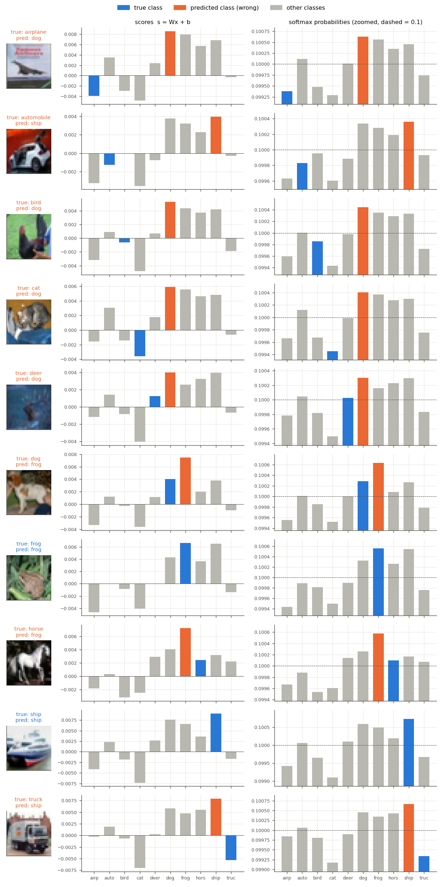
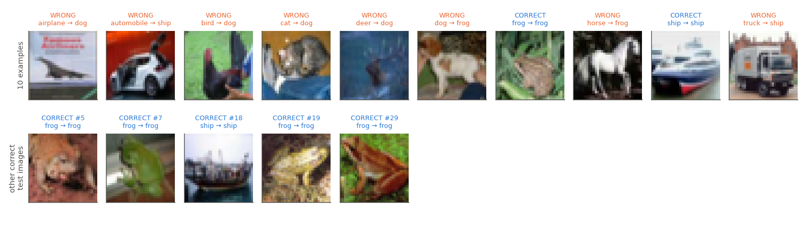
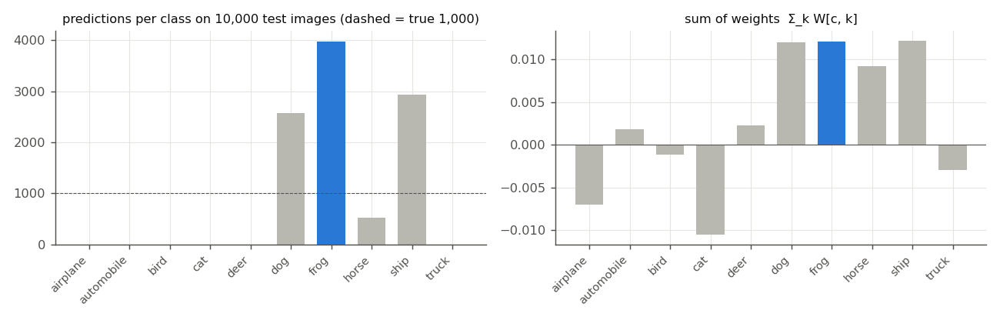
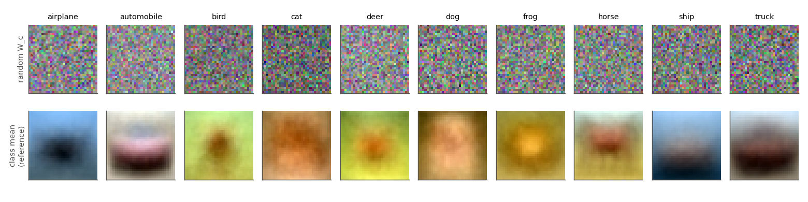

# Linear Classifier on CIFAR-10 with Random Weights

Submitted: November 18, 2026 · [한국어 버전](report_ko.md)

## 1. Summary

- W (10×3072) was drawn from N(0, 0.0001²) with seed 42 and b was set to 0. Scores were computed with f(x) = Wx + b, with no training.
- Of 10 test images (one per class), **2 were classified correctly (frog, ship)**. This is not recognition: the random W happens to favor frog, ship and dog for every input (Section 7).
- All scores are below 0.01 in magnitude, so the **average SVM loss is 9.0044 ≈ C−1 = 9**, **every softmax probability lies in 0.0991–0.1007 (≈ 1/10)**, and the average cross-entropy loss is 2.3030 ≈ ln 10. These are exactly the values expected from an untrained model.
- Each class's weights rendered as a 32×32×3 image are **colored noise**: correlation with the class mean image is |r| < 0.05, and neighboring-pixel correlation is 0.007 (vs 0.995 for real images).

## 2. Setup

| Item | Value |
|---|---|
| Data | CIFAR-10 test batch, 10,000 images (32×32×3 = 3,072 dims) |
| Preprocessing | Pixels 0–255 divided by 255 → [0, 1] |
| Weights | W ∈ ℝ^(10×3072), each entry ~ N(0, 0.0001²), `np.random.default_rng(42)` |
| Bias | b = 0 ∈ ℝ^10 |
| Example images | First test image of each class, 10 in total (indices 3, 6, 25, 0, 22, 12, 4, 13, 1, 11) |
| SVM margin | Δ = 1 |
| Training | None |

## 3. Implementation

Everything is implemented from scratch in NumPy (`linear_classifier.py`).

```python
def init_params(seed=42, std=1e-4, num_classes=10, dim=3072):
    rng = np.random.default_rng(seed)
    W = std * rng.standard_normal((num_classes, dim))
    b = np.zeros(num_classes)
    return W, b

def scores(W, b, X):            # X: (N, 3072), one image x per row
    return X @ W.T + b          # per image this is exactly W @ x + b

def svm_loss_per_example(S, y, delta=1.0):
    n = len(y)
    correct = S[np.arange(n), y][:, None]
    margins = np.maximum(0.0, S - correct + delta)
    margins[np.arange(n), y] = 0.0          # skip the j == y_i term
    return margins.sum(axis=1)              # L_i = Σ_{j≠y_i} max(0, s_j − s_{y_i} + Δ)

def softmax(S):
    Z = S - S.max(axis=1, keepdims=True)    # numerical stability, same result
    E = np.exp(Z)
    return E / E.sum(axis=1, keepdims=True)
```

`test_linear.py` checks that:

- initializing twice with the same seed gives an identical W (reproducibility);
- batched scores equal per-image `Wx + b`;
- the vectorized SVM loss equals a textbook loop version on 200 images, and the lecture example (cat/car/frog scores 3.2, 5.1, −1.7 → loss 2.9);
- softmax rows sum to 1, are positive, are invariant to adding a constant, preserve the argmax, and do not overflow at ±1000.

## 4. Class scores and predictions (f(x) = Wx + b)

| Index | True | Pred | airplane | automobile | bird | cat | deer | dog | frog | horse | ship | truck |
|---|---|---|---|---|---|---|---|---|---|---|---|---|
| 3 | airplane | dog | −0.00393 | +0.00351 | −0.00295 | −0.00486 | +0.00242 | **+0.00858** | +0.00796 | +0.00577 | +0.00687 | −0.00032 |
| 6 | automobile | ship | −0.00327 | −0.00128 | −0.00006 | −0.00355 | −0.00075 | +0.00376 | +0.00321 | +0.00228 | **+0.00398** | −0.00028 |
| 25 | bird | dog | −0.00317 | +0.00090 | −0.00059 | −0.00481 | +0.00069 | **+0.00533** | +0.00440 | +0.00378 | +0.00421 | −0.00187 |
| 0 | cat | dog | −0.00156 | +0.00305 | −0.00144 | −0.00361 | +0.00175 | **+0.00588** | +0.00554 | +0.00462 | +0.00483 | −0.00063 |
| 22 | deer | dog | −0.00117 | +0.00142 | −0.00084 | −0.00405 | +0.00122 | **+0.00401** | +0.00259 | +0.00326 | +0.00396 | −0.00068 |
| 12 | dog | frog | −0.00330 | +0.00124 | −0.00029 | −0.00362 | +0.00117 | +0.00403 | **+0.00745** | +0.00200 | +0.00382 | −0.00098 |
| 4 | frog | **frog ✓** | −0.00463 | −0.00005 | −0.00086 | −0.00405 | +0.00002 | +0.00429 | **+0.00664** | +0.00366 | +0.00650 | −0.00137 |
| 13 | horse | frog | −0.00180 | +0.00033 | −0.00318 | −0.00246 | +0.00293 | +0.00405 | **+0.00725** | +0.00246 | +0.00321 | +0.00223 |
| 1 | ship | **ship ✓** | −0.00412 | +0.00232 | −0.00183 | −0.00732 | +0.00271 | +0.00759 | +0.00659 | +0.00364 | **+0.00906** | −0.00164 |
| 11 | truck | ship | −0.00033 | +0.00191 | −0.00070 | −0.00704 | +0.00024 | +0.00583 | +0.00471 | +0.00554 | **+0.00791** | −0.00533 |

Bold marks the highest score (the prediction). Full values are in `results/scores.csv`.



Blue is the true class, orange a wrong prediction. Scores stay below 0.01 because each weight is about ±0.0001; summing 3,072 such products with pixels in [0, 1] gives a standard deviation of about 0.0001 × ‖x‖ ≈ 0.003.

## 5. Multiclass SVM loss

L_i = Σ_{j≠y_i} max(0, s_j − s_{y_i} + Δ), Δ = 1

| Index | True | L_i |
|---|---|---|
| 3 | airplane | 9.06236 |
| 6 | automobile | 9.01686 |
| 25 | bird | 9.01477 |
| 0 | cat | 9.05455 |
| 22 | deer | 8.99746 |
| 12 | dog | 8.97119 |
| 4 | frog | 8.94378 |
| 13 | horse | 8.99048 |
| 1 | ship | 8.92639 |
| 11 | truck | 9.06602 |
| **Average** | | **9.00439** |

Since all scores are far smaller than Δ = 1, s_j − s_{y_i} ≈ 0 and each of the 9 wrong classes contributes max(0, ≈0 + 1) ≈ 1, so L_i ≈ C − 1 = 9. This matches the sanity check from class: right after small random initialization the SVM loss should be about C − 1. The two correct images (frog 8.944, ship 8.926) are slightly below 9 because the true score is a little higher, but nowhere near the required margin of 1, so the loss barely drops.

## 6. Softmax

| Index | airplane | automobile | bird | cat | deer | dog | frog | horse | ship | truck | Sum |
|---|---|---|---|---|---|---|---|---|---|---|---|
| 3 | 0.09938 | 0.10012 | 0.09947 | 0.09929 | 0.10001 | 0.10063 | 0.10057 | 0.10035 | 0.10046 | 0.09974 | 1.000000000000 |
| 6 | 0.09963 | 0.09983 | 0.09995 | 0.09960 | 0.09988 | 0.10034 | 0.10028 | 0.10019 | 0.10036 | 0.09993 | 1.000000000000 |
| 25 | 0.09959 | 0.10000 | 0.09985 | 0.09943 | 0.09998 | 0.10045 | 0.10035 | 0.10029 | 0.10033 | 0.09972 | 1.000000000000 |
| 0 | 0.09966 | 0.10012 | 0.09967 | 0.09946 | 0.09999 | 0.10040 | 0.10037 | 0.10028 | 0.10030 | 0.09975 | 1.000000000000 |
| 22 | 0.09979 | 0.10004 | 0.09982 | 0.09950 | 0.10003 | 0.10030 | 0.10016 | 0.10023 | 0.10030 | 0.09983 | 1.000000000000 |
| 12 | 0.09956 | 0.10001 | 0.09986 | 0.09952 | 0.10000 | 0.10029 | 0.10063 | 0.10008 | 0.10027 | 0.09979 | 1.000000000000 |
| 4 | 0.09944 | 0.09989 | 0.09981 | 0.09949 | 0.09990 | 0.10033 | 0.10056 | 0.10026 | 0.10055 | 0.09976 | 1.000000000000 |
| 13 | 0.09967 | 0.09988 | 0.09953 | 0.09960 | 0.10014 | 0.10025 | 0.10058 | 0.10009 | 0.10017 | 0.10007 | 1.000000000000 |
| 1 | 0.09942 | 0.10006 | 0.09965 | 0.09910 | 0.10010 | 0.10059 | 0.10049 | 0.10019 | 0.10074 | 0.09967 | 1.000000000000 |
| 11 | 0.09984 | 0.10006 | 0.09980 | 0.09917 | 0.09990 | 0.10046 | 0.10034 | 0.10043 | 0.10066 | 0.09934 | 1.000000000000 |

**Scores vs probabilities**

- Scores can be negative and have no fixed total; probabilities are all positive and **sum to 1 for every image** (max deviation from 1: 2.2×10⁻¹⁶, i.e. floating-point round-off).
- Softmax uses the monotonic exp, so **ranking is preserved**: for all 10 images the argmax of the scores equals the argmax of the probabilities (the two bar charts in the figure have the same shape).
- Score differences are below 0.01, so exp(s) ≈ 1 + s and every probability is close to 1/10 (0.0991–0.1007): the model is not confident about anything. The probability axis in the figure is zoomed around 0.1 so these differences are visible.
- The average cross-entropy loss −log p_{y_i} is **2.30303**, essentially ln 10 = 2.30259, again the expected value at initialization.

**Supplementary: effect of the weight scale** (same seed, same 10 images, `results/weight_scale.csv`)

| W std | Mean \|score\| | SVM loss | Mean max prob | Softmax loss |
|---|---|---|---|---|
| 0.0001 (this run) | 0.0033 | 9.004 | 0.1005 | 2.303 |
| 0.001 | 0.0332 | 9.044 | 0.1054 | 2.308 |
| 0.01 | 0.3317 | 9.570 | 0.1599 | 2.414 |
| 0.1 | 3.3166 | 30.017 | 0.6139 | 6.288 |

The direction of W is the same in every row, so predictions do not change. With larger weights, however, the probabilities concentrate on one class (max prob 0.61), so an untrained model looks "confident", and wrong predictions are penalized heavily. This is why small initial weights are used.

## 7. Correct and misclassified examples



- Top row: among the 10 chosen images, **frog (index 4) and ship (index 1) are correct; the other 8 are wrong.** Every wrong prediction is dog, frog or ship.
- Bottom row: five other correctly classified test images. They are all frog or ship as well.

**Why?** Applying the same W to all 10,000 test images (for interpretation, not as an evaluation metric):



- Predictions are frog 3,978, ship 2,932, dog 2,567, horse 519: **99.96% of all predictions fall into four classes**, and airplane, bird and cat are never predicted. 1,193 images (about 12%) are correct, close to random guessing (10%).
- The cause is that all input pixels are non-negative (mean ≈ 0.48). In s_j = Σ_k W[j,k]·x_k, since every x_k is positive, the score is driven mostly by "mean brightness × the weight sum Σ_k W[j,k]". This approximation correlates with the actual scores at **r = 0.951**.
- The largest weight sums belong to ship (+0.0122), frog (+0.0121), dog (+0.0120) and horse (+0.0092); the smallest to cat (−0.0105) and airplane (−0.0070). So frog, ship and dog score high **for any input image**.
- The frog and ship images are therefore correct not because the model recognized a frog or a ship, but because images of those classes were fed into a W that is already tilted toward them. Conversely, an airplane or cat image can never be classified correctly with this W. (Zero-centering the data by subtracting the mean image would reduce this bias; the preprocessing here only scales to [0, 1].)

**Summary per true class** (whole test set, 1,000 images per class, `results/per_class.csv`)

The 10 examples above use only one image per class and could be a matter of luck, so the same W was applied to the whole test set and grouped by true class (for interpretation, not as an evaluation metric). The label of the dog class is 5; class names and label indices are read from the dataset's `batches.meta`.

| True class (label) | Correct / 1000 | Mean SVM loss | Mean softmax loss | Mean p(true class) | Most frequent predictions |
|---|---|---|---|---|---|
| airplane (0) | 0 | 9.0515 | 2.3077 | 0.09949 | dog 402, ship 382, frog 169 |
| automobile (1) | 1 | 8.9993 | 2.3025 | 0.10001 | frog 435, ship 265, dog 220 |
| bird (2) | 0 | 9.0175 | 2.3043 | 0.09982 | frog 480, dog 270, ship 223 |
| cat (3) | 0 | 9.0608 | 2.3087 | 0.09939 | frog 409, ship 298, dog 204 |
| deer (4) | 0 | 9.0033 | 2.3029 | 0.09997 | frog 591, ship 210, dog 177 |
| dog (5) | 156 | 8.9575 | 2.2983 | 0.10043 | frog 442, ship 354, dog 156 |
| frog (6) | **651** | 8.9511 | 2.2977 | 0.10049 | frog 651, ship 170, dog 129 |
| horse (7) | 41 | 8.9683 | 2.2994 | 0.10032 | frog 356, ship 323, dog 279 |
| ship (8) | **344** | 8.9516 | 2.2978 | 0.10048 | dog 414, ship 344, frog 208 |
| truck (9) | 0 | 9.0399 | 2.3066 | 0.09960 | ship 363, dog 316, frog 237 |
| **All** | **1,193** | **9.0001** | **2.3026** | | |

- **Losses are nearly identical across classes:** SVM loss 8.95–9.06 (≈ 9), softmax loss 2.298–2.309 (≈ ln 10).
- **Correct counts differ greatly by class:** frog 651, ship 344, dog 156, horse 41, and 0–1 for the other six classes. The classes that get hits are exactly the four with the largest weight sums (ship, frog, dog, horse).
- **Whatever the true class, the top three predictions are frog, ship and dog.** The model is tilted the same way regardless of image content, which is the same conclusion as the frog and ship hits among the 10 examples.

## 8. Weight visualization



The top row shows each class weight vector W_c (3,072 values) reshaped to 32×32×3 and min–max normalized. The bottom row shows the mean test image of each class for comparison (these are not trained weights).

**Why random weights show no meaningful class patterns**

1. **They have never seen data.** In a trained linear classifier, W_c is updated to reduce the loss and becomes a "template" resembling its class (e.g. blue sky for airplane, blue water at the bottom for ship, much like the mean images in the bottom row). Here no gradient step was taken, so W contains no information about the data.
2. **Every entry is independent.** The 3,072 values were drawn independently, so neighboring pixels are unrelated. Neighboring pixels in real images are almost identical (correlation 0.995), whereas in W the correlation is 0.007, effectively zero. No shapes, edges or color regions can form; only colored noise is visible.
3. **Class names are just row indices.** All 10 rows come from the same distribution and are statistically interchangeable. The correlation between W_c and its class mean image ranges from −0.040 to +0.045, essentially zero.
4. **Min–max normalization** stretches values of size 0.0001 to the full display range, which makes the noise look even more pronounced.

## 9. Conclusion

The untrained linear classifier computes scores, losses and softmax probabilities correctly, and the results look exactly like a model that knows nothing: SVM loss ≈ 9, softmax loss ≈ ln 10 and probabilities ≈ 0.1 serve as sanity checks that the implementation is right. The few correct predictions are coincidental, and the weight images only take the form of class templates once training happens.

## 10. How to run and files

```bash
pip install -r requirements.txt
python test_linear.py <path to cifar-10-python.tar.gz>   # implementation checks
python run.py <path to cifar-10-python.tar.gz>           # full experiment + figures (a few seconds)
```

| File | Content |
|---|---|
| `linear_classifier.py` | data loading, initialization, f(x)=Wx+b, SVM loss, softmax, cross-entropy |
| `run.py` | runs the experiment, saves results, draws figures |
| `test_linear.py` | implementation checks |
| `results/run.log` | full console output |
| `results/scores.csv`, `probabilities.csv`, `losses.csv` | scores, probabilities and losses of the 10 examples |
| `results/per_class.csv` | per-true-class summary over the whole test set |
| `results/weight_scale.csv` | supplementary weight-scale experiment |
| `results/summary.json` | key numbers |
| `figures/*.png` | four figures |
