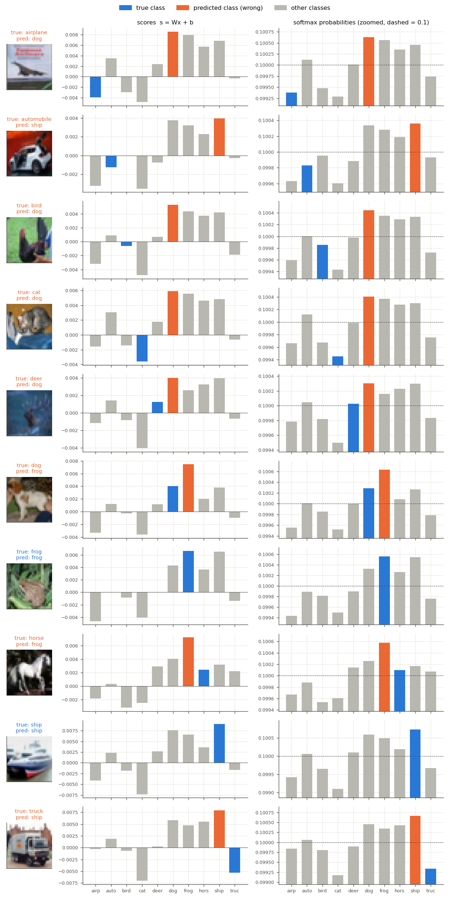
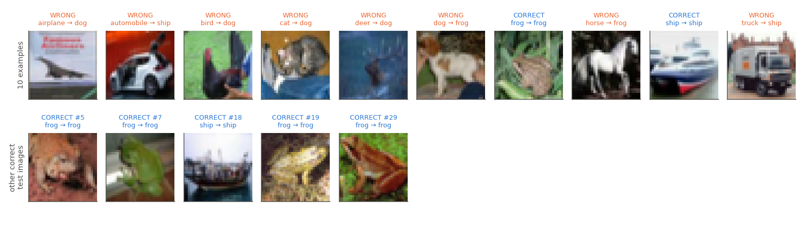
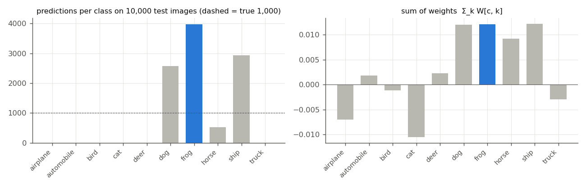
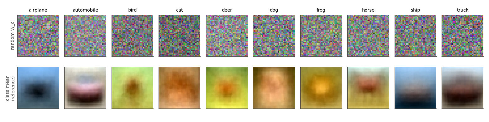

# CIFAR-10 선형 분류기 (무작위 가중치) 실험 보고서

제출일: 2026년 11월 18일 · [English version](report.md)

## 1. 요약

- 가중치 W(10×3072)를 N(0, 0.0001²)에서 seed=42로 뽑고 b=0으로 둔 뒤, 학습 없이 f(x) = Wx + b로 점수를 계산했습니다.
- 테스트셋에서 클래스당 1장씩 고른 10장 중 **2장(frog, ship)이 맞았습니다.** 하지만 이는 이미지를 알아본 결과가 아니라, 무작위 W가 원래부터 frog·ship·dog 쪽 점수를 높게 주는 경향 때문입니다(5절).
- 점수가 ±0.01 이하로 매우 작아서 **SVM 손실 평균은 9.0044 ≈ C−1 = 9**, **Softmax 확률은 모두 0.0991–0.1007로 거의 1/10**, 교차 엔트로피 손실은 2.3030 ≈ ln 10 이었습니다. 모두 "학습 전 모델"에서 이론적으로 기대되는 값입니다.
- 각 클래스의 가중치를 32×32×3 이미지로 그리면 **색깔 있는 잡음**일 뿐이고, 클래스 평균 이미지와의 상관은 |r| < 0.05, 이웃 픽셀 간 상관은 0.007 (실제 이미지는 0.995) 이었습니다.

## 2. 실험 설정

| 항목 | 내용 |
|---|---|
| 데이터 | CIFAR-10 테스트 배치 10,000장 (32×32×3 = 3,072차원) |
| 전처리 | 픽셀값 0–255를 255로 나눠 [0, 1]로 스케일 |
| 가중치 | W ∈ ℝ^(10×3072), 각 원소 ~ N(0, 0.0001²), `np.random.default_rng(42)` |
| 편향 | b = 0 ∈ ℝ^10 |
| 예시 이미지 | 테스트셋에서 각 클래스가 처음 나오는 이미지 1장씩, 총 10장 (인덱스 3, 6, 25, 0, 22, 12, 4, 13, 1, 11) |
| SVM margin | Δ = 1 |
| 학습 | 하지 않음 |

## 3. 구현

모든 계산은 NumPy로 직접 구현했습니다(`linear_classifier.py`).

```python
def init_params(seed=42, std=1e-4, num_classes=10, dim=3072):
    rng = np.random.default_rng(seed)
    W = std * rng.standard_normal((num_classes, dim))
    b = np.zeros(num_classes)
    return W, b

def scores(W, b, X):            # X: (N, 3072), 각 행이 이미지 x
    return X @ W.T + b          # 한 장씩 보면 W @ x + b 와 같음

def svm_loss_per_example(S, y, delta=1.0):
    n = len(y)
    correct = S[np.arange(n), y][:, None]
    margins = np.maximum(0.0, S - correct + delta)
    margins[np.arange(n), y] = 0.0          # j == y_i 항 제외
    return margins.sum(axis=1)              # L_i = Σ_{j≠y_i} max(0, s_j − s_{y_i} + Δ)

def softmax(S):
    Z = S - S.max(axis=1, keepdims=True)    # 오버플로 방지 (결과는 동일)
    E = np.exp(Z)
    return E / E.sum(axis=1, keepdims=True)
```

`test_linear.py`에서 다음을 확인했습니다.

- 같은 seed로 두 번 초기화하면 W가 완전히 같음 (재현성)
- 행렬 한 번에 계산한 점수 = 이미지 한 장씩 `Wx + b`를 계산한 점수
- 벡터화한 SVM 손실 = for문으로 짠 교과서식 SVM 손실 (200장 모두), 강의 예제(cat/car/frog 점수 3.2, 5.1, −1.7 → 손실 2.9)도 일치
- Softmax 각 행의 합 = 1, 모든 값 > 0, 상수를 더해도 결과 불변, argmax 보존, 큰 값(±1000)에도 overflow 없음

## 4. 클래스 점수와 예측 (f(x) = Wx + b)

| 인덱스 | 정답 | 예측 | airplane | automobile | bird | cat | deer | dog | frog | horse | ship | truck |
|---|---|---|---|---|---|---|---|---|---|---|---|---|
| 3 | airplane | dog | −0.00393 | +0.00351 | −0.00295 | −0.00486 | +0.00242 | **+0.00858** | +0.00796 | +0.00577 | +0.00687 | −0.00032 |
| 6 | automobile | ship | −0.00327 | −0.00128 | −0.00006 | −0.00355 | −0.00075 | +0.00376 | +0.00321 | +0.00228 | **+0.00398** | −0.00028 |
| 25 | bird | dog | −0.00317 | +0.00090 | −0.00059 | −0.00481 | +0.00069 | **+0.00533** | +0.00440 | +0.00378 | +0.00421 | −0.00187 |
| 0 | cat | dog | −0.00156 | +0.00305 | −0.00144 | −0.00361 | +0.00175 | **+0.00588** | +0.00554 | +0.00462 | +0.00483 | −0.00063 |
| 22 | deer | dog | −0.00117 | +0.00142 | −0.00084 | −0.00405 | +0.00122 | **+0.00401** | +0.00259 | +0.00326 | +0.00396 | −0.00068 |
| 12 | dog | frog | −0.00330 | +0.00124 | −0.00029 | −0.00362 | +0.00117 | +0.00403 | **+0.00745** | +0.00200 | +0.00382 | −0.00098 |
| 4 | frog | **frog ✓** | −0.00463 | −0.00005 | −0.00086 | −0.00405 | +0.00002 | +0.00429 | **+0.00664** | +0.00366 | +0.00650 | −0.00137 |
| 13 | horse | frog | −0.00180 | +0.00033 | −0.00318 | −0.00246 | +0.00293 | +0.00405 | **+0.00725** | +0.00246 | +0.00321 | +0.00223 |
| 1 | ship | **ship ✓** | −0.00412 | +0.00232 | −0.00183 | −0.00732 | +0.00271 | +0.00759 | +0.00659 | +0.00364 | **+0.00906** | −0.00164 |
| 11 | truck | ship | −0.00033 | +0.00191 | −0.00070 | −0.00704 | +0.00024 | +0.00583 | +0.00471 | +0.00554 | **+0.00791** | −0.00533 |

굵은 값이 가장 높은 점수(= 예측 클래스)입니다. 전체 값은 `results/scores.csv`에 있습니다.



파란색은 정답 클래스, 주황색은 틀린 예측 클래스입니다. 점수 크기가 모두 0.01 미만인 것은 W의 원소가 약 ±0.0001이고, 픽셀값(0–1) 3,072개를 곱해 더해도 표준편차가 약 0.0001 × √(Σx²) ≈ 0.003 정도에 그치기 때문입니다.

## 5. Multiclass SVM 손실

L_i = Σ_{j≠y_i} max(0, s_j − s_{y_i} + Δ), Δ = 1

| 인덱스 | 정답 | L_i |
|---|---|---|
| 3 | airplane | 9.06236 |
| 6 | automobile | 9.01686 |
| 25 | bird | 9.01477 |
| 0 | cat | 9.05455 |
| 22 | deer | 8.99746 |
| 12 | dog | 8.97119 |
| 4 | frog | 8.94378 |
| 13 | horse | 8.99048 |
| 1 | ship | 8.92639 |
| 11 | truck | 9.06602 |
| **평균** | | **9.00439** |

모든 점수가 Δ = 1보다 훨씬 작기 때문에 s_j − s_{y_i} ≈ 0 이고, 오답 클래스 9개 각각이 max(0, ≈0 + 1) ≈ 1씩 기여합니다. 그래서 L_i ≈ C − 1 = 9가 됩니다. 이는 강의에서 다룬 "초기화 직후 SVM 손실은 약 C−1이어야 한다"는 sanity check와 일치합니다. 맞힌 두 장(frog 8.944, ship 8.926)은 정답 점수가 다른 점수보다 조금 높아서 9보다 약간 작지만, 여전히 margin 1을 확보하지 못했기 때문에 손실은 거의 줄지 않았습니다.

## 6. Softmax

| 인덱스 | airplane | automobile | bird | cat | deer | dog | frog | horse | ship | truck | 합 |
|---|---|---|---|---|---|---|---|---|---|---|---|
| 3 | 0.09938 | 0.10012 | 0.09947 | 0.09929 | 0.10001 | 0.10063 | 0.10057 | 0.10035 | 0.10046 | 0.09974 | 1.000000000000 |
| 6 | 0.09963 | 0.09983 | 0.09995 | 0.09960 | 0.09988 | 0.10034 | 0.10028 | 0.10019 | 0.10036 | 0.09993 | 1.000000000000 |
| 25 | 0.09959 | 0.10000 | 0.09985 | 0.09943 | 0.09998 | 0.10045 | 0.10035 | 0.10029 | 0.10033 | 0.09972 | 1.000000000000 |
| 0 | 0.09966 | 0.10012 | 0.09967 | 0.09946 | 0.09999 | 0.10040 | 0.10037 | 0.10028 | 0.10030 | 0.09975 | 1.000000000000 |
| 22 | 0.09979 | 0.10004 | 0.09982 | 0.09950 | 0.10003 | 0.10030 | 0.10016 | 0.10023 | 0.10030 | 0.09983 | 1.000000000000 |
| 12 | 0.09956 | 0.10001 | 0.09986 | 0.09952 | 0.10000 | 0.10029 | 0.10063 | 0.10008 | 0.10027 | 0.09979 | 1.000000000000 |
| 4 | 0.09944 | 0.09989 | 0.09981 | 0.09949 | 0.09990 | 0.10033 | 0.10056 | 0.10026 | 0.10055 | 0.09976 | 1.000000000000 |
| 13 | 0.09967 | 0.09988 | 0.09953 | 0.09960 | 0.10014 | 0.10025 | 0.10058 | 0.10009 | 0.10017 | 0.10007 | 1.000000000000 |
| 1 | 0.09942 | 0.10006 | 0.09965 | 0.09910 | 0.10010 | 0.10059 | 0.10049 | 0.10019 | 0.10074 | 0.09967 | 1.000000000000 |
| 11 | 0.09984 | 0.10006 | 0.09980 | 0.09917 | 0.09990 | 0.10046 | 0.10034 | 0.10043 | 0.10066 | 0.09934 | 1.000000000000 |

**점수와 확률 비교**

- 점수는 음수도 있고 합이 정해져 있지 않지만, 확률은 모두 양수이고 **각 이미지마다 합이 1**입니다(1과의 최대 차이 2.2×10⁻¹⁶, 부동소수점 오차 수준).
- Softmax는 단조 증가 함수 exp를 쓰므로 **순위가 보존**됩니다. 10장 모두 점수의 argmax와 확률의 argmax가 같았습니다(위 그림에서 두 막대 그래프 모양이 같음).
- 점수 차이가 0.01 미만이므로 exp(s) ≈ 1 + s 이고, 확률은 모두 1/10 근처(0.0991–0.1007)입니다. 모델이 어느 클래스에도 확신이 없다는 뜻입니다. 그림의 확률 축은 이 차이를 보이도록 0.1 근처를 확대한 것입니다.
- 교차 엔트로피 손실 −log p_{y_i}의 평균은 **2.30303**으로 ln 10 = 2.30259와 거의 같습니다. 이것도 초기화 직후의 기대값입니다.

**보충: 가중치 크기에 따른 변화** (같은 seed, 같은 10장, `results/weight_scale.csv`)

| W 표준편차 | 평균 \|점수\| | SVM 손실 | 평균 최대 확률 | Softmax 손실 |
|---|---|---|---|---|
| 0.0001 (본 실험) | 0.0033 | 9.004 | 0.1005 | 2.303 |
| 0.001 | 0.0332 | 9.044 | 0.1054 | 2.308 |
| 0.01 | 0.3317 | 9.570 | 0.1599 | 2.414 |
| 0.1 | 3.3166 | 30.017 | 0.6139 | 6.288 |

W가 같은 방향이고 크기만 다르므로 예측 클래스는 바뀌지 않습니다. 하지만 크기를 키우면 확률이 한 클래스에 쏠려서(최대 확률 0.61) 아무 것도 배우지 않았는데도 "확신"하는 것처럼 보이고, 틀린 예측에 큰 벌점이 붙어 손실이 크게 늘어납니다. 작은 초기화를 쓰는 이유를 보여줍니다.

## 7. 맞은 예시와 틀린 예시



- 윗줄: 고른 10장 중 **frog(4번), ship(1번) 2장이 맞았고 나머지 8장은 틀렸습니다.** 틀린 예측은 모두 dog, frog, ship 중 하나입니다.
- 아랫줄: 테스트셋 전체에서 맞은 다른 이미지 5장인데, 역시 모두 frog 아니면 ship입니다.

**왜 이런 결과가 나왔는가?** 참고로 테스트셋 10,000장 전체에 같은 W를 적용하면(평가 지표가 아닌 해석용):



- 예측이 frog 3,978, ship 2,932, dog 2,567, horse 519장으로 **네 클래스에 99.96%가 몰렸고**, airplane·bird·cat은 한 번도 예측되지 않았습니다. 맞은 개수는 1,193장(약 12%)으로 무작위 추측(10%)과 비슷합니다.
- 원인은 입력 픽셀이 모두 0 이상(평균 약 0.48)이라는 점입니다. s_j = Σ_k W[j,k]·x_k 에서 x가 모두 양수이므로, 점수는 대략 "이미지 평균 밝기 × 가중치 합 Σ_k W[j,k]"에 의해 결정됩니다. 실제로 이 근사값과 실제 점수의 상관계수는 **0.951**이었습니다.
- 가중치 합이 가장 큰 클래스가 ship(+0.0122), frog(+0.0121), dog(+0.0120), horse(+0.0092)이고, 가장 작은 클래스가 cat(−0.0105), airplane(−0.0070)입니다. 따라서 **어떤 이미지가 들어와도** frog·ship·dog가 높은 점수를 받습니다.
- 즉 frog와 ship 이미지가 맞은 것은 모델이 개구리나 배를 알아봐서가 아니라, 우연히 그 클래스로 쏠려 있는 W에 그 클래스 이미지가 들어갔기 때문입니다. 반대로 airplane, cat 같은 클래스는 아무리 전형적인 이미지라도 맞힐 수가 없습니다. (평균 이미지를 빼는 zero-centering을 하면 이 쏠림은 줄지만, 이번 과제의 전처리는 [0,1] 스케일만 했습니다.)

## 8. 가중치 시각화



윗줄은 각 클래스의 가중치 벡터 W_c(3,072개)를 32×32×3으로 바꾸고 최솟값–최댓값으로 정규화해 그린 것입니다. 아랫줄은 비교용으로 해당 클래스 테스트 이미지 평균을 그린 것입니다(학습된 가중치가 아님).

**무작위 가중치에서 의미 있는 패턴이 안 보이는 이유**

1. **데이터를 본 적이 없습니다.** 학습된 선형 분류기에서 W_c는 손실을 줄이는 방향으로 갱신되며 해당 클래스 이미지와 닮은 "템플릿"이 됩니다(예: airplane은 파란 하늘 배경, ship은 아래쪽 파란 바다, 아랫줄 평균 이미지와 비슷한 모습). 이번에는 경사하강법을 한 번도 하지 않았기 때문에 W에는 데이터에 대한 정보가 전혀 없습니다.
2. **모든 원소가 서로 독립입니다.** 3,072개 값이 각각 독립적으로 뽑혔기 때문에 이웃한 픽셀끼리 아무 관련이 없습니다. 실제 이미지는 이웃 픽셀이 거의 같은 값(상관 0.995)이지만, W의 이웃 픽셀 상관은 0.007로 사실상 0입니다. 그래서 모양이나 경계, 색 영역이 생길 수 없고 컬러 잡음만 보입니다.
3. **클래스 이름은 행 번호일 뿐입니다.** 10개 행은 같은 분포에서 뽑혀 서로 바꿔도 통계적으로 구별되지 않습니다. 실제로 W_c와 해당 클래스 평균 이미지의 상관계수는 −0.040 ~ +0.045로 0에 가깝습니다.
4. **최솟값–최댓값 정규화**를 하면 0.0001 크기의 값도 화면 전체 밝기 범위로 늘어나기 때문에 잡음이 더 강조되어 보입니다.

## 9. 결론

학습하지 않은 선형 분류기는 점수 계산, 손실 계산, Softmax 변환이 모두 정상적으로 동작하지만, 결과는 "아무 것도 모르는 모델"의 전형적인 모습을 보였습니다. SVM 손실 ≈ 9, Softmax 손실 ≈ ln 10, 확률 ≈ 0.1이라는 결과는 구현이 맞다는 sanity check가 됩니다. 일부 맞은 예측은 우연이며, 가중치 이미지는 학습이 일어나야 비로소 클래스 템플릿 형태를 갖게 됩니다.

## 10. 실행 방법과 파일

```bash
pip install -r requirements.txt
python test_linear.py <cifar-10-python.tar.gz 경로>   # 구현 검증
python run.py <cifar-10-python.tar.gz 경로>           # 전체 실험 + 그림 생성 (수 초)
```

| 파일 | 내용 |
|---|---|
| `linear_classifier.py` | 데이터 로딩, 초기화, f(x)=Wx+b, SVM 손실, Softmax, 교차 엔트로피 |
| `run.py` | 실험 실행, 결과 저장, 그림 생성 |
| `test_linear.py` | 구현 검증 |
| `results/run.log` | 실행 출력 전체 |
| `results/scores.csv`, `probabilities.csv`, `losses.csv` | 예시 10장의 점수·확률·손실 |
| `results/weight_scale.csv` | 가중치 크기 보충 실험 |
| `results/summary.json` | 주요 수치 요약 |
| `figures/*.png` | 그림 4개 |
